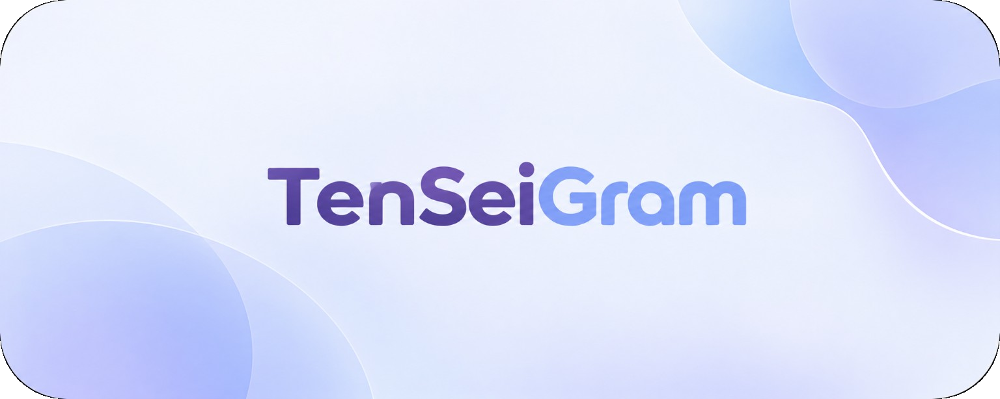
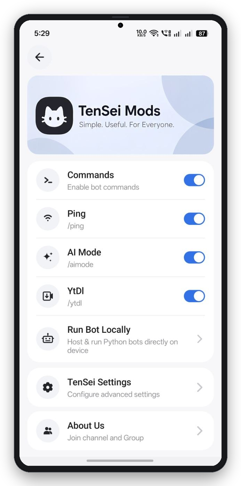
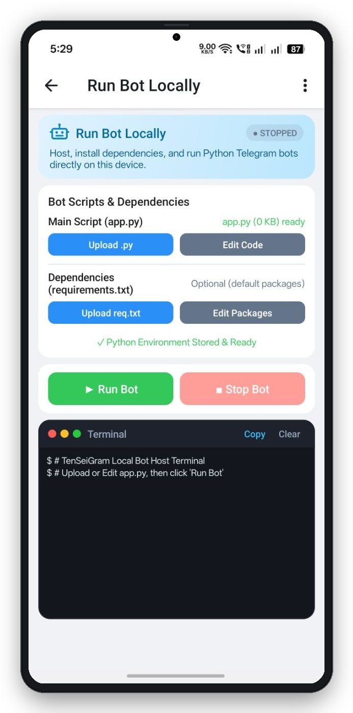
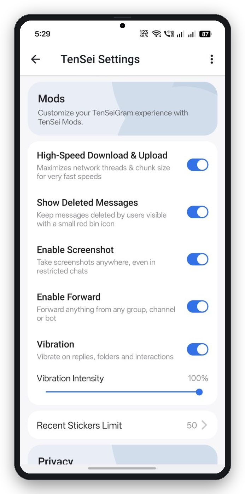
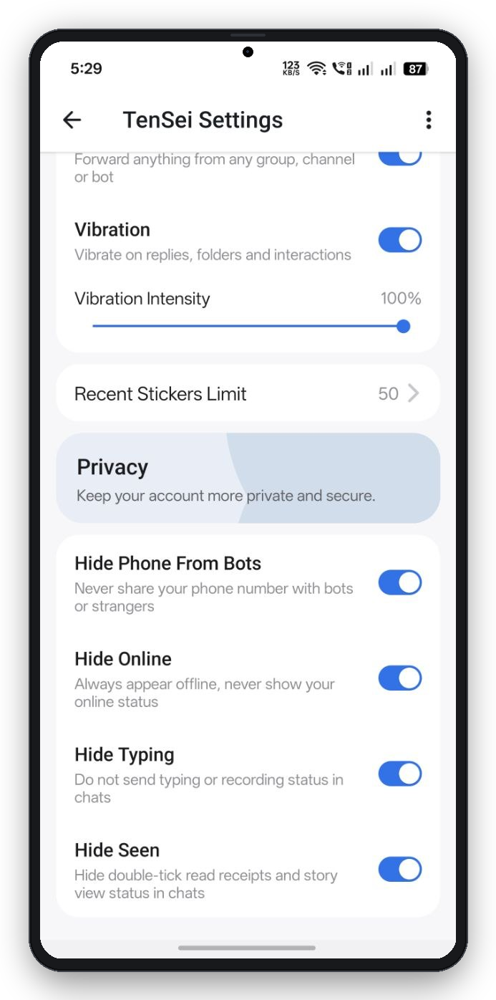
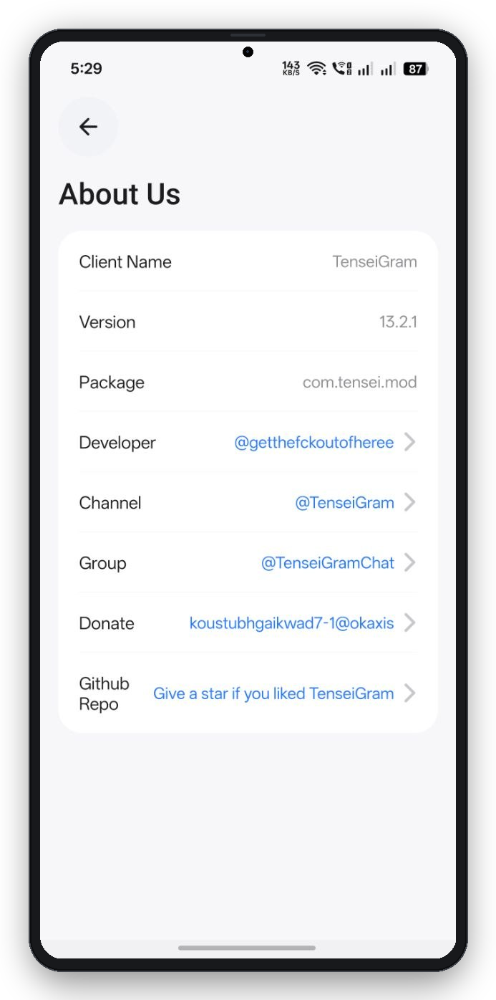

 

**Customized Telegram client for Android - privacy, performance and control.**

 

 

 

 

 

  <a href="#overview">Overview</a> • <a href="#key-features">Features</a> • <a href="#run-bot-locally">Run Bot Locally</a> • <a href="#standard-telegram-vs-tenseigram">Comparison</a> • <a href="#screenshots">Screenshots</a> • <a href="#get-tenseigram">Download</a> • <a href="#developer">Developer</a> • <a href="#community">Community</a>

---

## Overview

**TenSeiGram** is an independent build of the Telegram Android client, extended with custom modifications, privacy controls, transfer optimizations, on-device Python bot hosting, and practical everyday tools.

Everything the standard client already does is preserved. What is added lives in a separate section called **TenSei Mods**, where each modification is an individual toggle — nothing is forced, and nothing replaces an existing Telegram setting.

| | |
| :--- | :--- |
| <svg xmlns="http://www.w3.org/2000/svg" width="18" height="18" viewBox="0 0 24 24" fill="none" stroke="#2AABEE" stroke-width="2" stroke-linecap="round" stroke-linejoin="round"><rect x="3" y="3" width="18" height="18" rx="4"/><path d="M8 12h8M12 8v8"/></svg> | Original Telegram interface, fully intact |
| <svg xmlns="http://www.w3.org/2000/svg" width="18" height="18" viewBox="0 0 24 24" fill="none" stroke="#6C5CE7" stroke-width="2" stroke-linecap="round" stroke-linejoin="round"><path d="M12 3 4 7v6c0 4.4 3.4 7.4 8 8 4.6-.6 8-3.6 8-8V7z"/></svg> | Modifications isolated inside TenSei Mods |
| <svg xmlns="http://www.w3.org/2000/svg" width="18" height="18" viewBox="0 0 24 24" fill="none" stroke="#0F766E" stroke-width="2" stroke-linecap="round" stroke-linejoin="round"><circle cx="12" cy="12" r="9"/><path d="M12 7v5l3.5 2"/></svg> | Every option applies instantly, no restart |

> TenSeiGram is not affiliated with, endorsed by or connected to Telegram FZ-LLC. See the [Disclaimer](#disclaimer).

---

## Key Features

| | Feature | Description |
| :---: | :--- | :--- |
| <svg xmlns="http://www.w3.org/2000/svg" width="18" height="18" viewBox="0 0 24 24" fill="none" stroke="#0284C7" stroke-width="2" stroke-linecap="round"><rect x="3" y="4" width="18" height="16" rx="3"/><path d="M8 10h.01M16 10h.01M9 16h6"/></svg> | **Run Bot Locally** | Host & run Python Telegram bots directly on-device with zero server costs, in-process runtime, and macOS-style terminal. |
| <svg xmlns="http://www.w3.org/2000/svg" width="18" height="18" viewBox="0 0 24 24" fill="none" stroke="#6C5CE7" stroke-width="2" stroke-linecap="round"><path d="M4 6h10M18 6h2M4 12h4M12 12h8M4 18h10M18 18h2"/><circle cx="16" cy="6" r="2"/><circle cx="10" cy="12" r="2"/><circle cx="16" cy="18" r="2"/></svg> | **TenSei Mods** | A dedicated section housing every TenSeiGram modification and control. |
| <svg xmlns="http://www.w3.org/2000/svg" width="18" height="18" viewBox="0 0 24 24" fill="none" stroke="#E91E63" stroke-width="2" stroke-linecap="round" stroke-linejoin="round"><path d="M21 12a8 8 0 0 1-8 8H4l2.5-3A8 8 0 1 1 21 12z"/><circle cx="12" cy="12" r="2.5"/></svg> | **Hide Typing** | Prevents typing and recording indicators from being sent in chats. |
| <svg xmlns="http://www.w3.org/2000/svg" width="18" height="18" viewBox="0 0 24 24" fill="none" stroke="#9C27B0" stroke-width="2" stroke-linecap="round" stroke-linejoin="round"><path d="M1.5 12S5 5.5 12 5.5 22.5 12 22.5 12 19 18.5 12 18.5 1.5 12 1.5 12z"/><circle cx="12" cy="12" r="3"/></svg> | **Hide Seen** | Withholds read receipts and story-view status from other users. |
| <svg xmlns="http://www.w3.org/2000/svg" width="18" height="18" viewBox="0 0 24 24" fill="none" stroke="#C0392B" stroke-width="2" stroke-linecap="round" stroke-linejoin="round"><path d="M4 6h16M9 6V4h6v2M6 6l1 14h10l1-14M10 10v6M14 10v6"/></svg> | **Show Deleted Messages** | Retains deleted messages in place with a clear deleted-message indicator. |
| <svg xmlns="http://www.w3.org/2000/svg" width="18" height="18" viewBox="0 0 24 24" fill="none" stroke="#2980B9" stroke-width="2" stroke-linecap="round" stroke-linejoin="round"><circle cx="12" cy="12" r="9"/><path d="M12 7v5l3.5 2"/></svg> | **View Edit History** | Displays the previous and updated versions of edited messages. |
| <svg xmlns="http://www.w3.org/2000/svg" width="18" height="18" viewBox="0 0 24 24" fill="none" stroke="#8E44AD" stroke-width="2" stroke-linecap="round" stroke-linejoin="round"><rect x="4" y="10" width="16" height="10" rx="2"/><path d="M8 10V7a4 4 0 0 1 8 0v3"/></svg> | **Hide Phone From Bots** | Never share your phone number with bots or strangers. |
| <svg xmlns="http://www.w3.org/2000/svg" width="18" height="18" viewBox="0 0 24 24" fill="none" stroke="#2AABEE" stroke-width="2" stroke-linecap="round" stroke-linejoin="round"><path d="M22 2 11 13M22 2l-7 20-4-9-9-4z"/></svg> | **Enable Forward** | Forward anything from any group, channel or bot. |
| <svg xmlns="http://www.w3.org/2000/svg" width="18" height="18" viewBox="0 0 24 24" fill="none" stroke="#16A085" stroke-width="2" stroke-linecap="round" stroke-linejoin="round"><path d="M13 2 4 14h7l-1 8 9-12h-7z"/></svg> | **High-Speed Transfer** | Tuned networking threads and chunk sizes for faster downloads and uploads. |
| <svg xmlns="http://www.w3.org/2000/svg" width="18" height="18" viewBox="0 0 24 24" fill="none" stroke="#0F766E" stroke-width="2" stroke-linecap="round" stroke-linejoin="round"><rect x="7" y="7" width="10" height="10" rx="2"/><rect x="10" y="10" width="4" height="4"/><path d="M10 3v4M14 3v4M10 17v4M14 17v4M3 10h4M3 14h4M17 10h4M17 14h4"/></svg> | **AI Mode** | Answers requests through 10 AI models with automatic fallback on failure. |
| <svg xmlns="http://www.w3.org/2000/svg" width="18" height="18" viewBox="0 0 24 24" fill="none" stroke="#D35400" stroke-width="2" stroke-linecap="round" stroke-linejoin="round"><path d="M12 3v11M7.5 10 12 14.5 16.5 10M4 20h16"/></svg> | **Media Downloader** | Saves YouTube, Instagram and TikTok videos locally and re-uploads them via Telegram. |

---

## Run Bot Locally

TenSeiGram includes a built-in **Local Bot Runner**, allowing you to host and execute Python Telegram bots directly on your Android phone without needing VPS hosting, Heroku, or external servers.

- **Direct On-Device Hosting**: Upload or write any `app.py` script and `requirements.txt`.
- **Integrated In-Process Engine**: Zero extra size added to the APK; runs safely without root or SELinux permission blocks.
- **Full Media Access**: Supports photo, video, and document processing with multipart uploads.
- **macOS Terminal UI**: Real-time streaming logs with clean output, touch scrolling, and one-click Copy / Clear actions.
- **Permanent Package Storage**: Downloaded runtimes and dependencies remain saved locally without re-downloading.
- **One-Click Cache Management**: Top 3-dots menu to wipe all cached data, scripts, and temporary files whenever needed.

---

## Standard Telegram vs TenSeiGram

| Capability | Standard Telegram | TenSeiGram |
| :--- | :---: | :---: |
| Chats, media, calls, stickers | ✓ | ✓ |
| Official MTProto API | ✓ | ✓ |
| Account, privacy and notification settings | ✓ | ✓ |
| **Run Bot Locally (On-Device Python Hosting)** | — | **✓** |
| **Hide Typing** | — | **✓** |
| **Hide Seen** | — | **✓** |
| **Show Deleted Messages** | — | **✓** |
| **View Edit History** | — | **✓** |
| **Hide Phone From Bots** | — | **✓** |
| **Enable Forward** | — | **✓** |
| **High-Speed Download & Upload** | — | **✓** |
| **AI Mode (10 models with fallback)** | — | **✓** |
| **Media Downloader (YouTube / Instagram / TikTok)** | — | **✓** |
| **Command Manager** | — | **✓** |

---

## Screenshots

| TenSei Mods | Run Bot Locally |
| :---: | :---: |
|  |  |

| TenSei Settings | Privacy Controls |
| :---: | :---: |
|  |  |

| About TenSeiGram |
| :---: |
|  |

---

## Get TenSeiGram

&nbsp;

&nbsp;

  

### Available Downloads (Version 13.2.1)

| Build Variant | Architecture | Size | Recommendation | Direct Download |
| :--- | :--- | :---: | :--- | :--- |
| **TenSeiGram ARM64** | `arm64-v8a` | ~58 MB | **Recommended**: Faster, optimized for all modern phones | [📥 Download ARM64 APK](https://github.com/Koustubh12345/TenSeiGram/releases/download/v13.2.1/TenSeiGram-v13.2.1-arm64-v8a.apk) |
| **TenSeiGram Universal** | `arm64-v8a`, `armeabi-v7a`, `x86`, `x86_64` | ~73 MB | Compatible with all Android devices, tablets & emulators | [📥 Download Universal APK](https://github.com/Koustubh12345/TenSeiGram/releases/download/v13.2.1/TenSeiGram-v13.2.1-universal.apk) |

---

## Project Information

| Property | Details |
| :--- | :--- |
| **Client** | TenSeiGram |
| **Version** | `13.2.1` |
| **Package** | `com.tensei.mod` |
| **Platform** | Android |
| **Architecture** | ARM64-v8a, ARMv7a, x86, x86_64 |
| **Protocol** | MTProto |
| **CI / CD** | GitHub Actions Automated Builds |

---

## Suggestions & Support

| Channel | Purpose | Link |
| :--- | :--- | :--- |
| **Updates** | Releases, announcements and status posts. | [@TenseiGram](https://t.me/TenseiGram) |
| **Community** | Discussion, feedback and support. | [@TenseiGramChat](https://t.me/TenseiGramChat) |

---

## Developer

TenSeiGram is developed and maintained independently by **Koustubh Gaikwad**.

| Platform | Account | Link |
| :--- | :--- | :--- |
| **Telegram** | `@getthefckoutofheree` | [t.me/getthefckoutofheree](https://t.me/getthefckoutofheree) |
| **GitHub** | `@Koustubh12345` | [github.com/Koustubh12345](https://github.com/Koustubh12345) |

  
  

---

## Disclaimer

TenSeiGram is an independent third-party Telegram client.

TenSeiGram is not affiliated with, endorsed by, sponsored by or officially connected to Telegram or Telegram FZ-LLC. Telegram and all related trademarks belong to their respective owners.

Users are responsible for complying with Telegram's Terms of Service and all applicable laws.

---

